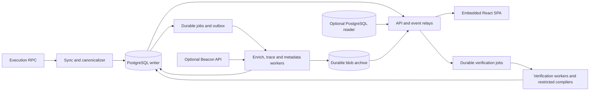

# Architecture Overview

Etherview is a single-chain execution-layer explorer packaged as one Go binary
with an embedded React SPA. PostgreSQL owns chain identity, canonical history,
work scheduling and publication. Optional services extend capabilities without
replacing that authority.

## Runtime Shape

The same component graph runs as `serve --roles=all` or split-role processes.
Typed builders register each role's components; an independent production
manifest and parity tests enforce identical behavior across both layouts.
The shared supervisor owns startup, readiness, cancellation and bounded shutdown.
Operational readiness requires PostgreSQL; API readiness also requires durable
core readiness. See [runtime and component boundaries](runtime.md) and
[ADR-0001](../decisions/ADR-0001-modular-roles-and-postgresql-truth.md).

The diagram shows data flow, not independent databases for each role. API
admission, worker leases and publication all use the same PostgreSQL authority.
A configured reader serves only eligible projections; correctness fences stay
on the writer. Verification workers own compiler execution; API processes admit
and read jobs. Compiler catalogs, metadata sources and payment facilitators have
separate bounded external-service contracts.

## Chain Correctness

Each deployment binds chain ID and genesis hash. Blocks retain immutable hash
identity; canonical height is a mutable mapping, and reorgs retain orphan facts.
Live-head sync and historical backfill share durable coverage, so an isolated
higher block cannot establish complete history or readiness.

Core facts commit atomically. Derived output becomes visible only through the
exact canonical block, stage version, lease and publication generation. Reorgs
and replay withdraw stale publications; raw rows alone never prove readiness.
RPC state reads stay pinned to one endpoint and exact block hash, without
falling back to height or `latest`. Database snapshots close before external
calls, and publication rechecks identity and ownership afterward. See
[indexing](indexing.md), [durable publication](publication.md) and
[ADR-0012](../decisions/ADR-0012-lease-fenced-derived-publication.md).

## Public Boundaries

The native API lives under `/api/v1`, Etherscan compatibility under `/v2/api`,
and operational endpoints on a separate listener. OpenAPI owns generated server
and browser contracts; integers beyond JavaScript's safe range are strings.
Unavailable, incomplete and observed-empty data remain distinct states.

Explorer traffic uses the generated same-origin client. Contract calls and
transactions use the injected wallet boundary. Browser sessions, API keys and
payment identities retain separate authorization rules. Compiler execution,
metadata retrieval and external adapters enforce bounded work, network policy
and redacted typed errors. See [API contracts](api.md), [Web boundaries](web.md)
and [accounts and billing](billing.md).

## Storage and optional capabilities

PostgreSQL owns canonical mappings, jobs, leases, manifests and publication.
NATS wake notifications, Redis and normalized-trace object caches are disposable
accelerators with bounded fallback. The blob archive is different: it durably
owns raw bodies, while PostgreSQL owns their identity and visibility. Losing
archived bodies affects retrieval and requires recovery.

Consensus observations and blob/request workers are optional enrichment; they
do not drive execution fork choice or core readiness. Contract verification
requires local compiler matching and canonical publication checks; an external
source label does not establish local verification. See
[storage boundaries](storage.md), [consensus and archives](consensus.md) and
[verification](verification.md).

## Domain designs

| Domain                                                                       | Detailed design                                                                          |
| ---------------------------------------------------------------------------- | ---------------------------------------------------------------------------------------- |
| Components, package boundaries, readiness, telemetry and replica ownership   | [Runtime](runtime.md)                                                                    |
| PostgreSQL pools, SQL ownership, partitions and disposable accelerators      | [Storage](storage.md)                                                                    |
| Genesis, RPC ingestion, coverage, reorgs, repair and pending transactions    | [Chain indexing](indexing.md)                                                            |
| Leases, generations, journals, outbox, events, statistics and UserOperations | [Durable publication](publication.md)                                                    |
| Trace, proxy, Diamond, CWIA, ABI and execution identity                      | [Contract intelligence](contract-intelligence.md)                                        |
| Verification jobs, compilers, Sourcify and source discovery                  | [Contract verification](verification.md)                                                 |
| HTTP contracts, search, partial browsing and event-log queries               | [Public API](api.md) and [Etherscan compatibility matrix](etherscan-v2-compatibility.md) |
| Embedded assets, client lifecycle, watches, push, exports and Turnstile      | [Web and browser services](web.md)                                                       |
| ENS discovery, registration, resolution, history and invalidation            | [Background ENS](ens.md)                                                                 |
| Balances, holder reconciliation, NFT metadata and media                      | [Tokens and NFTs](tokens.md)                                                             |
| Keys, prepaid credit, payment options and facilitator settlement             | [Accounts and billing](billing.md)                                                       |
| Amsterdam, Beacon observations, execution requests and blob archives         | [Consensus and protocol projections](consensus.md)                                       |
| Disposable local nodes, gateway, genesis contracts and payment fixtures      | [Preview architecture](../../preview/docs/architecture.md)                               |

## Source-of-Truth Routing

This overview and its topic documents describe current architecture. Accepted
[ADRs](../decisions/index.md) explain consequential decisions and remain mandatory.
[Development](../development.md) owns change workflow;
[testing](../testing.md) and the [Makefile](../../Makefile) own validation;
[operations](../operations.md) owns deployment, telemetry interpretation and recovery.
[Plans](../plans/index.md) retain substantial delivery milestones, acceptance and
unresolved blockers. Routine change evidence belongs in PRs and Git.
